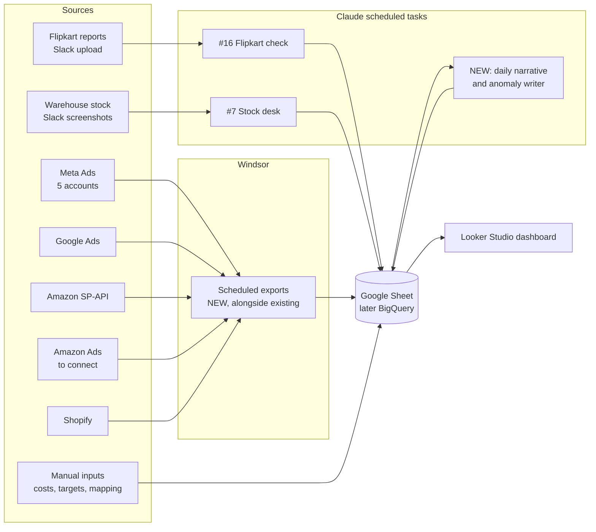

# Auravedic Commerce Dashboard: Scope Document

**Version:** 1.0 (draft for review)
**Date:** 30 October 2026
**Owner:** Auravedic (founder / growth)
**Companion document:** `Auravedic_Dashboard_Context_Handbook.md` (all background, definitions, account IDs and data caveats)

---

## 1. Purpose

Build one external dashboard that lives outside Claude and covers every Auravedic sales channel. Anyone on the team should be able to open it without a Claude account. It should answer three questions every day:

1. **How much did we sell, where, and at what profit?** (Shopify, Amazon, Flipkart and other marketplaces)
2. **What did we spend to get those sales, and was it worth it?** (Meta, Google, Amazon Ads, Flipkart Ads)
3. **What should we do next?** (budget moves, products to push or fix, stock to reorder, problems to chase)

It replaces the Claude-hosted "Auravedic cross-channel performance" dashboard as the main view. The Claude dashboard can stay as a working prototype while the external one is built.

### 1.1 Decisions already made

| Decision | Choice | Why |
|---|---|---|
| Ad and Amazon data pipeline | **Windsor.ai scheduled exports** to a destination (Google Sheets first) | Steadier and cheaper than a Claude-run sync. Adds new export tasks and changes nothing in the existing Windsor connections, cache tasks or reports. |
| Existing Windsor setup | **Leave untouched** | The daily ads report, the weekly Meta refresh, the Flipkart check and this dashboard all read from Windsor today. |
| Claude's role | Analysis, narrative, anomaly flags, and the sources Windsor cannot carry (Shopify, Flipkart reports from Slack) | Covers the parts that need judgment or have no API. |

### 1.2 Decisions still open

| # | Question | Options | Recommendation |
|---|---|---|---|
| D1 | Where does the dashboard live? | Looker Studio (free), Metabase (free, self-hosted), Power BI, custom web app | **Looker Studio** for phase 1. It reads Google Sheets and BigQuery natively, costs nothing and is shared with a Google link. Move to a custom app only if Looker hits limits. |
| D2 | Storage layer | Google Sheets now, BigQuery later | Sheets for phase 1. Plan the move to **BigQuery** (also a Windsor destination) once daily SKU-level data gets past roughly 2–3 million cells, or when queries get slow. |
| D3 | Which marketplaces exist beyond Shopify, Amazon and Flipkart? | Nykaa (an SKU map exists in the inventory sheets), Myntra, Meesho, Tira, Purplle, Blinkit, Zepto, Swiggy Instamart, JioMart | **Confirm the live list.** See Section 3.2. |
| D4 | Who maintains the dashboard? | In-house, agency, Claude scheduled tasks | One named owner, with Claude tasks feeding the non-Windsor sources. |
| D5 | Windsor Basic plan limits | Number of destination tasks, rows, refresh frequency | Check in the Windsor billing page before creating more than 3–4 exports. |

---

## 2. Users and what each needs

| User | Main questions | Views they live in |
|---|---|---|
| Founder / owner | Are we profitable? Which channel is growing? Where is the money going? | Executive summary, P&L, channel mix, month on month |
| Performance marketer | Which accounts, campaigns and creatives work? Where should budget move? | Ads performance, MER / ROAS, creative fatigue, budget pacing |
| Marketplace manager | How are Amazon and Flipkart doing on sales, rank, price, stock and ads? | Marketplace pages, ASIN / FSN funnel, Buy Box, ad ROI |
| Ops / warehouse | What will run out? What is stuck? Where are returns coming from? | Inventory cover, RTO / NDR, cancellations, regional dispatch |
| Finance | What did we actually net after fees, refunds, shipping and COGS? | Realistic P&L, settlement reconciliation, payout tracking |

---

## 3. Data sources

### 3.1 Sources connected today

| # | Source | What it gives | Route today | Route in the external build | Cost | Status |
|---|---|---|---|---|---|---|
| S1 | **Meta Ads**: 5 accounts (New26, Auravedic Internal, MP2, Auravedic GC, Fresh Pixel). Auravedic Admin is excluded. | Spend, impressions, clicks, purchases, purchase value, at account, campaign, ad set and ad level, daily | Windsor `facebook` | Windsor export → Sheet tab `meta_daily` (campaign level) and `meta_ads_daily` (ad level, optional) | Included in Windsor | Ready |
| S2 | **Google Ads**: account 318-241-3276 | Spend, impressions, clicks, conversions, conversion value, by campaign, daily | Windsor `google_ads` | Windsor export → `google_daily` | Included | Ready |
| S3 | **Amazon.in Seller Central**: seller account A3OEY3JP0PGBDE-IN | Sales & Traffic by date and by child ASIN (sales, units, sessions, page views, Buy Box %, unit session %), all orders (with ship state and pincode), settlement v2, FBA inventory planning, unsuppressed inventory, merchant listings | Windsor `amazon_sp`. Windsor already refreshes about 10 of these reports daily into its cache. | Windsor exports → `amz_sales_date`, `amz_sales_asin`, `amz_orders`, `amz_settlement`, `amz_inventory` | Included | Ready |
| S4 | **Shopify**: AURAVEDIC store (auravedic.com, INR, IST) | Orders, gross / net sales, discounts, returns, units, sessions, landing pages, conversion, products, customers, payment status (COD vs prepaid), fulfilment status | Claude's Shopify connector | **Not in Windsor's connected list.** Two options: (a) connect Shopify in Windsor (`shopify` is a supported connector), or (b) a Shopify custom app plus a small script, or a Claude scheduled task, writing to the Sheet. **Recommend (a)** so all exports work the same way. Connecting a new source doesn't change the existing ones. | (a) depends on the Windsor plan · (b) free | To do |
| S5 | **Flipkart**: Seller Hub reports | Orders (order lines, status, FBF / non-FBF, SLA breaches, return reasons), daily product sales, FBF inventory, Flipkart Ads campaign report | Reports posted in Slack #flipkart-reports, parsed daily by the scheduled task "#16 Flipkart reports daily check" into the Flipkart dashboard | Extend task #16 to also write the cleaned tables to the Sheet (`fk_orders`, `fk_sales_daily`, `fk_ads`, `fk_fbf_stock`) | Free | Partial |
| S6 | **Stock desk**: warehouse stock (CBE, Mumbai) and combo recipes | Stock in hand, D2C available, bulk reserve, and recipes linking listings to base products | Nightly scheduled task "#7 Auravedic WH Inventory Desk", built from warehouse screenshots in Slack #inventory-wh-movement | Extend the nightly task to write `stock_daily` and `recipes` tabs | Free | Partial |

### 3.2 Marketplaces to confirm and connect

Windsor has **no connector** for Flipkart, Nykaa, Myntra, Meesho or the quick-commerce apps. These need either a seller API or a report-upload routine (post in Slack, then a Claude task parses it, the same pattern Flipkart uses today).

| Marketplace | Likely status | Data route | Notes |
|---|---|---|---|
| Amazon.in | Live | Windsor (SP-API) | Fully automatable. |
| Flipkart | Live | Slack upload → Claude task. The Order Management API may be free for a seller's own account (to be confirmed). | The Reports API (settlements, P&L) is paid and partner-only. Settlement reports are still missing. |
| Nykaa | **Confirm.** An SKU map for Nykaa exists in "Monthly inventory calculations and tracking". | Report upload (Nykaa seller panel exports) | Same Slack pattern as Flipkart. |
| Myntra, Meesho, Tira, Purplle | Confirm | Report upload | Add only if live. |
| Blinkit, Zepto, Instamart | Confirm | Partner portal exports | Usually weekly sell-through files. |

**Action:** the owner lists every live marketplace and its seller-panel export options before phase 2.

### 3.3 Data you already have but don't use yet (suggested additions)

These can be reached from the current setup for little or no extra cost. They are ranked by how much insight they add.

| Priority | Data | Where it comes from | What it unlocks |
|---|---|---|---|
| ★★★ | **Amazon Ads**: Sponsored Products, Brands and Display, by campaign and ASIN | Windsor `amazon_ads`. It is not connected now; an old cache task for profile 1844743165607135 exists but is deactivated. | True Amazon ACOS / TACOS. Removes the biggest blind spot in "sales per ₹1 of ads". Amazon bills about ₹25–30k a day in ads, which is invisible in the ads totals today. |
| ★★★ | **Amazon Sales & Traffic by ASIN** (sessions, page views, Buy Box %, conversion) | Windsor `amazon_sp`, already cached daily | The marketplace funnel. Shows whether a drop comes from traffic, conversion or lost Buy Box. |
| ★★★ | **Shopify sessions and landing pages** | Shopify analytics (already pulled daily by the ads report task) | Store conversion rate, landing-page conversion per ad destination, cart-to-checkout drop-off |
| ★★★ | **COD vs prepaid, RTO and NDR** | Shopify payment status, plus the Call & Chase ops data | The real cost of COD (failed deliveries, return shipping), and RTO by state |
| ★★ | **Customer cohorts**: new vs returning, repeat rate, LTV | Shopify customers and orders | Retention, LTV : CAC, the payback period on Meta spend |
| ★★ | **Helio AI chat sales** (WhatsApp, Instagram, site chat) | Helio connector (revenue by channel, conversion, objections, lost-sale reasons) | Revenue the chat agent drives, top objections, and an AI-assisted share of store sales |
| ★★ | **Amazon all-orders report** (ship state, pincode, promotion IDs) | Windsor `amazon_sp`, cached | Regional demand, promotion effectiveness, cancellations |
| ★★ | **Amazon FBA inventory and restock** | Windsor `amazon_sp`, cached | Days of cover per ASIN, stock-out risk, aged stock and storage fees |
| ★★ | **Amazon daily price / deal / rank / rating check** | The existing "run-amazon-check" routine (Google Sheet) | Price and deal changes against sales, keyword rank trend, rating drift |
| ★★ | **Meta ad-level and creative data** | Windsor `facebook` (ad level, used by the weekly "Meta ads: winners and losers" refresh) | Creative fatigue, new / stopped / improved ad sets, hook and angle tests |
| ★ | **Google Search Console** | Windsor `searchconsole` (supported, not connected) | Organic search demand for "kumkumadi", brand-search trend (a halo signal) |
| ★ | **GA4** | Windsor `googleanalytics4` (supported, not connected) | Traffic source quality, assisted conversions |
| ★ | **Google Merchant Center** | Windsor `google_merchant` | Shopping feed health, disapproved products |
| ★ | **Instagram / Facebook organic** | Windsor `instagram`, `facebook_organic` | Organic reach and engagement against paid performance |
| ★ | **Competitor ads** | SwipeKit library (trackers for Indulekha, Shesha Ayurveda, Nat Habit, Pilgrim, WishCare) | Creative benchmarking (qualitative) |

### 3.4 Data that has to come from people (manual inputs)

These have no API. Keep them in one Google Sheet tab each, owned by a named person.

| Input | Today | Needed for | Owner |
|---|---|---|---|
| **Landed cost per SKU** (or per base product) | Flat ₹125 per unit for every product | SKU and channel profit | Finance |
| Shipping cost per order | Flat ₹65 per Shopify order over ₹499 | Store P&L | Ops |
| Payment gateway and COD remittance fees | Missing | Store P&L | Finance |
| RTO / NDR costs from the courier partner | Missing | COD economics | Ops |
| Monthly overheads (team, tools, agency, packaging, warehouse) | Missing | Net profit (after contribution) | Finance |
| Campaign → product mapping | Missing | Ad spend by product, product ROAS | Marketing |
| Monthly targets (sales, spend, MER, by channel) | Missing | Pacing and forecast | Founder |
| Flipkart settlement reports | Missing | Flipkart P&L | Marketplace |
| Flipkart cancellation and return reason reports | Missing | Return-reason analysis | Marketplace |
| Amazon fee adjustment of 21 Oct (₹1.94L) explanation | Unclassified | Amazon P&L accuracy | Marketplace / finance |

---

## 4. Architecture

### 4.1 Storage layout (one Google Sheet workbook, one tab per table)

| Tab | Grain | Key | Refresh | Filled by |
|---|---|---|---|---|
| `meta_daily` | account × campaign × day | date, account_id, campaign_id | Daily, 06:00 IST | Windsor |
| `google_daily` | campaign × day | date, campaign_id | Daily | Windsor |
| `amzads_daily` | campaign × ASIN × day | date, campaign_id, asin | Daily | Windsor (once connected) |
| `amz_sales_date` | day | date | Daily | Windsor |
| `amz_sales_asin` | child ASIN × day | date, asin | Daily | Windsor |
| `amz_orders` | order line | amazon_order_id, sku | Daily | Windsor |
| `amz_settlement` | settlement line | settlement_id, posted_date, type | Weekly | Windsor |
| `amz_inventory` | ASIN snapshot | date, asin | Daily | Windsor |
| `shop_daily` | day | date | Daily | Windsor Shopify / script |
| `shop_sku_daily` | SKU × day | date, sku | Daily | Windsor Shopify / script |
| `shop_orders` | order (no personal data) | order_no | Daily | Windsor Shopify / script |
| `shop_sessions` | landing page × day | date, path | Daily | Script / Claude task |
| `fk_orders` | order line | order_item_id | Daily | Claude task #16 |
| `fk_sales_daily` | SKU × day | date, sku | Daily | Claude task #16 |
| `fk_ads` | campaign × report period | pstart, pend, campaign_id | Weekly | Claude task #16 |
| `stock_daily` | base product × warehouse × day | date, key, wh | Nightly | Claude task #7 |
| `dim_products` | listing (SKU / ASIN / FSN) | channel, code | On change | Manual + Claude |
| `dim_recipes` | listing → base product × qty | channel, code, base_key | On change | Stock desk |
| `dim_costs` | base product | base_key | Monthly | Finance |
| `dim_targets` | channel × month | month, channel | Monthly | Founder |
| `notes` | dated note | date, channel | As needed | Anyone |
| `narrative` | day | date | Daily | Claude (new task) |

**Rules**
- **No personal data in the Sheet:** no customer names, phones, emails or addresses. Order numbers, states and pincodes are enough.
- **Dates and currency:** every date in IST, `YYYY-MM-DD`. Every amount in INR, without GST unless the column says otherwise.
- **Windsor exports append or upsert.** Keep the last 13 months daily, so year-on-year comparisons work next year.

### 4.2 Why this keeps the current setup safe

- **Windsor:** destination tasks are new objects. The existing Meta / Google / Amazon connections, the 13 cache tasks and every report that reads Windsor keep working as they are.
- **Claude scheduled tasks** (#7, #9, #16, the weekly Meta refresh): unchanged. Phase 2 only adds a "also write to the Sheet" step to #7 and #16.
- **The Claude-hosted dashboards** keep running until the external one is signed off.

---

## 5. Metric definitions (single source of truth)

These must match the existing Claude dashboards, so numbers agree during the transition. Full formulas are in the Context Handbook, Section 7.

| Metric | Definition |
|---|---|
| **Shopify sales (headline)** | Gross sales − discounts, **before** returns. Net sales drop returns on the day they are processed, which makes some months look weak (August 2026 especially). |
| Shopify net sales | Gross − discounts − returns (Shopify `net_sales`) |
| **Amazon sales** | Ordered product sales (Sales & Traffic report) |
| **Flipkart sales** | Seller Hub net sales where available. Otherwise **estimated** as units × current selling price (ran about 8% high on 28 Oct). Always labelled as an estimate. |
| **Total sales** | Shopify sales before returns + Amazon ordered sales (+ Flipkart, + other marketplaces, once real figures exist) |
| **Ad spend** | Meta (5 accounts) + Google. Amazon Ads and Flipkart Ads are added once their data is real and daily. **Every view states which platforms are included.** |
| **MER** (sales per ₹1 of ads) | Total sales ÷ total ad spend |
| Platform ROAS | Platform-attributed purchase value ÷ that platform's spend |
| ACOS / TACOS (Amazon) | Amazon Ads spend ÷ ad-attributed sales / ÷ total Amazon sales |
| **Dashboard P&L** | Total sales − ad spend. A quick contribution view, with no product, shipping or fee costs. |
| **Realistic P&L** | Store: Shopify net − COGS (₹125 × units) − shipping (₹65 × orders over ₹499) − Meta + Google spend. Amazon: settlement principal − refunds − promotions (net of shipping income) − fees − billed ads − COGS. Combined = store + Amazon. |
| Contribution margin | Realistic profit ÷ net revenue |
| CAC (new customer) | Ad spend ÷ new Shopify customers |
| AOV | Sales ÷ orders, per channel |
| Days of cover | Sellable stock ÷ average daily units over the last 14 days (counting combo components through the recipes) |

**Data quality rules carried over**
- Drop any Meta ad-day with more than ₹50,000 purchase value per purchase. For example, MP2 on 21 Jul 2026 reported ₹4.4 crore for 46 purchases.
- Fresh Pixel's "BOM_Sales_Prospecting_IC_16.09" optimises for Initiate Checkout on remarketing audiences. Never rank it against purchase-optimised prospecting campaigns.
- Google spend spikes on 16 and 17 Jun 2026 stay in the figures, and are noted.

---

## 6. Dashboard structure (pages)

Every page shares a header: a date range control (Yesterday, 7, 14, 30 days, MTD, custom, each with a comparison period), a channel filter, a **data freshness strip** (last day loaded per source, with a red flag when a source is behind), and a **coverage badge** (for example, "Ad spend: Meta + Google. Amazon Ads not included").

### Page 1: Executive summary
- **KPI tiles**, each against the prior period and against target: total sales, ad spend, MER, realistic profit, contribution %, orders, AOV, new customers, CAC.
- Channel mix: a stacked bar of sales by channel over time.
- Five auto-written findings and up to three actions (written by the Claude narrative task, stored in `narrative`).
- MTD pacing against the monthly target, plus a month-end forecast.

### Page 2: Profit and loss
- Both P&Ls side by side (dashboard basis and realistic), per period and by month.
- A waterfall: sales → returns → discounts → COGS → shipping → marketplace fees → ads → contribution → overheads → net.
- Per-channel P&L: Shopify, Amazon, Flipkart (once settlement data exists) and other marketplaces.
- A "what's missing" panel that lists assumed or missing inputs live (from Section 3.4).

### Page 3: Advertising
- Spend, ROAS and MER by platform, account and campaign, with a 7-day rolling line.
- **Blended view:** total spend against total sales, with a lag view (does Meta spend lift Amazon sales 1–3 days later?).
- Campaign table: spend, purchases, CPP, ROAS, CTR, CPM, frequency (where available), trend arrow, live / paused.
- Budget pacing: daily spend against planned budget, by account.
- Creative panel: new, stopped, improved and dropped ad sets this week (from the weekly Meta refresh logic). Fatigue is flagged when CTR falls and frequency rises.
- Amazon Ads (once connected): ACOS, TACOS, spend by campaign type, top search terms.
- Flipkart Ads: ROI by campaign, spend against revenue, paused campaigns that still had ROI.

### Page 4: Shopify (D2C store)
- Funnel: sessions → add to cart → checkout → orders, plus conversion rate by landing page and by ad destination.
- COD vs prepaid share, RTO % by state, and the cost of failed COD deliveries.
- New vs returning customers, repeat rate, and a 30/60/90-day cohort LTV.
- Discount depth and its effect on AOV and conversion.
- Reversal days (large returns or cancellations), flagged.
- AI chat (Helio): attributed revenue, top questions and objections.

### Page 5: Marketplaces
- Amazon:
  - Sales, units, sessions, unit session %, Buy Box %, by ASIN.
  - Refunds and returns.
  - Settlement-based net payout.
  - Price / deal / keyword rank / rating trend (from the daily Amazon check).
- Flipkart:
  - Orders and net sales (estimate vs real, labelled), delivered / returned / cancelled split.
  - FBF vs non-FBF.
  - Dispatch and delivery SLA breaches.
  - Ad ROI.
- Other marketplaces: one standard block each (sales, units, returns, stock, ads).
- Marketplace comparison: AOV, return rate, fee %, contribution per order, by channel.

### Page 6: Products
- Listing view: every SKU / ASIN / FSN with sales, units, return rate, and channel split.
- **Base-product view:** listings broken into the base products inside them using the recipes (for example, how much Kumkumadi Oil 100ml really sells across singles, packs and combos on every channel).
- Product P&L, once SKU costs exist: margin per unit by channel.
- Price comparison: the same product's price on Shopify, Amazon and Flipkart.
- Rising and falling products (week-on-week and month-on-month movers).

### Page 7: Inventory and operations
- Stock by base product and warehouse (CBE, Mumbai, Amazon FBA, Flipkart FBF).
- **Days of cover**, with red / amber / green, and reorder suggestions from demand across all channels.
- Stock-out impact: days out of stock × average daily sales = estimated lost sales.
- Aged or slow stock: stock with no sales in 30 days.
- RTO / NDR queue size (from Call & Chase), cancellations by reason.

### Page 8: Data health
- Last load per source, rows loaded, gaps by date.
- Coverage table: what is in each total and what isn't.
- Assumptions in use (COGS, shipping), with the date each was set.
- The reports-needed checklist.

---

## 7. Analyses (the insight layer)

Each analysis lists its question, method and data. Analyses marked **[auto]** run every day in the Claude narrative task and write findings to the `narrative` tab. The rest are weekly or monthly deep dives.

### 7.1 Growth and channel economics
1. **Channel mix shift [auto].** Track each channel's share of total sales and contribution. From April to September 2026, Amazon's share of sales fell from 65% to 49% while Shopify grew from ₹18.8L to ₹30.0L a month. Is that growth at the expense of profit? *Data:* monthly totals, P&L.
2. **MER efficiency curve.** Plot monthly and weekly spend against total sales to find diminishing returns. Sales per ₹1 of ads fell from ₹3.63 (April) to ₹2.70 (September) as spend rose from ₹14.7L to ₹21.6L. *Output:* the spend level beyond which an extra ₹1 returns less than its margin.
3. **Contribution by channel per order.** After fees, shipping, COGS and returns, what does one order on Shopify, Amazon and Flipkart actually earn? *Data:* realistic P&L, settlements, costs.
4. **Halo effect.** Does Meta spend lift Amazon and Flipkart sales and branded search? Use lagged correlation (0–3 days) and, later, geo or time holdout tests. *Data:* daily Meta spend, daily marketplace sales, Search Console brand queries.
5. **Incrementality tests (designed, not just observed).** Run 2–3 week geo-split or account-pause tests to measure the real lift from Meta and Google, beyond platform-attributed ROAS.

### 7.2 Advertising performance
6. **Account and campaign league table [auto].** ROAS, CPP and spend share per Meta account and campaign, with week-on-week movement. Flag a ≥15% change in spend or ROAS. Compare like with like (objective and audience type).
7. **Creative fatigue [auto].** Ad sets whose CTR falls and CPP rises over 7 days while frequency climbs. Recommend refresh or pause.
8. **Budget reallocation model.** Given marginal ROAS by account and campaign, which ₹X of budget should move where? Weekly.
9. **Amazon ACOS / TACOS by ASIN** (needs Amazon Ads). Which ASINs are ad-dependent and which sell organically? Where can bids come down?
10. **Flipkart Ads ROI by campaign.** Spend against revenue, paused campaigns that had ROI, and an estimate of ad dependency for Flipkart.
11. **Google Ads campaign efficiency.** Shopping vs Search vs PMax, conversion lag, and the effect of spend spikes.

### 7.3 Customers and store
12. **Cohort retention and LTV.** Repeat rate at 30, 60 and 90 days by first-order month and first product. Which hero product brings customers who come back?
13. **LTV : CAC and payback period.** By month and acquisition channel.
14. **COD economics [auto].** COD share, RTO rate, failed-delivery cost and net value of a COD order vs a prepaid order, by state. Supports decisions such as prepaid incentives and blocking COD in high-RTO states.
15. **Landing-page conversion.** Sessions and conversion rate by landing page and ad destination. Which pages lose money on paid traffic?
16. **Discount effectiveness.** Discount depth against AOV, conversion and margin. Which offers actually add profit?
17. **Free-shipping threshold test.** Order-value distribution around ₹499 and ₹1,200 (the free-toner threshold). Is the threshold nudging basket size?
18. **AI chat contribution.** Helio-attributed revenue, conversion of chats, top objections, and lost-sale reasons. Feeds FAQ and product page fixes.

### 7.4 Products
19. **Base-product demand across channels [auto].** True demand for each base product (for example, Kumkumadi Oil 100ml), counting singles, packs and combos on every channel.
20. **Product P&L by channel.** Margin per unit after real cost, fees and returns. Which SKUs to push, re-price or retire per channel.
21. **Return-rate outliers.** SKUs and channels with return or cancellation rates well above average, with reasons once Flipkart and Amazon return-reason data exists.
22. **Price parity and elasticity.** The same product's price across channels and its effect on sales mix. Spot channel cannibalisation.
23. **Combo performance.** Which combos raise AOV without hurting margin? Which singles are often bought together but have no combo?
24. **Amazon funnel by ASIN [auto].** A sales drop split into traffic (sessions), conversion (unit session %) and Buy Box loss.

### 7.5 Inventory and operations
25. **Days of cover and reorder alerts [auto].** Per base product and warehouse, from demand across all channels.
26. **Stock-out cost.** Lost sales estimated from out-of-stock days, per product.
27. **Slow and aged stock.** Stock with low sell-through, plus FBA / FBF storage-fee exposure.
28. **Regional demand.** Sales by state for each channel against the warehouse split (South ships from CBE, the rest from Mumbai). Does a third location, or FBA / FBF placement, pay off?
29. **Fulfilment SLA.** Dispatch and delivery breaches on Flipkart, and Shopify order-to-booking time.

### 7.6 Planning and monitoring
30. **Target pacing and month-end forecast [auto].** MTD against target, with a run-rate forecast and a range.
31. **Anomaly detection [auto].** Daily values outside a 28-day band (sales, spend, ROAS, refunds, reversals), per channel. Each one is labelled as a real event, a data glitch or a missing source.
32. **Seasonality and events.** Festive periods (Diwali, wedding season, end-of-season sales), Amazon and Flipkart sale events, and day-of-week patterns. Builds the calendar for budget planning.
33. **Scenario planner.** "If we raise Meta spend by 20%, cut COD in high-RTO states and lift AOV to ₹750, what happens to profit?" Uses the efficiency curve, COD economics and AOV analysis.

---

## 8. Delivery phases

| Phase | Scope | Key outputs | Depends on |
|---|---|---|---|
| **0. Prepare** (week 1) | Decide D1–D5. Create the Google Sheet workbook and tabs. Check Windsor plan limits. Fill `dim_costs` (even a rough per-product cost) and `dim_targets`. | Workbook and owner list | Owner |
| **1. Ads + Amazon + Shopify** (weeks 1–2) | Windsor exports for Meta, Google, Amazon sales / ASIN / settlement / inventory. Connect Shopify (Windsor or script). Build Pages 1, 2 (dashboard P&L), 3 and 8 in Looker Studio. | Live executive and ads pages | Phase 0 |
| **2. Marketplaces + products** (weeks 3–4) | Connect **Amazon Ads** in Windsor. Extend Claude tasks #16 (Flipkart) and #7 (stock) to write to the Sheet. Product master and recipes. Pages 4, 5, 6. | Marketplace and product pages, true ACOS | Amazon Ads access |
| **3. Profit + inventory** (weeks 5–6) | Realistic P&L with real SKU costs, gateway / COD / RTO costs, overheads. Inventory cover and reorder alerts. Page 7. Flipkart settlement-based P&L. | Full P&L, inventory page | Manual inputs (Section 3.4) |
| **4. Insight layer** (weeks 6–8) | New Claude scheduled task: reads the Sheet daily, runs the [auto] analyses, writes `narrative` and anomalies, posts a Slack summary. Monthly deep-dive report. | Daily narrative and alerts | Phases 1–3 |
| **5. Scale** (later) | Move storage to BigQuery when Sheets slows down. Add the remaining marketplaces. Incrementality tests. Scenario planner. | Faster dashboard, more channels | Data volume |

---

## 9. Acceptance criteria

- **Numbers reconcile.** For the same period, totals match the Claude dashboard within 1%, or the difference is explained (for example, a refreshed late-arriving Amazon day).
- **Freshness.** Ads, Shopify and Amazon have data through yesterday by 09:00 IST. Amazon may lag 2 days; that is labelled, not hidden.
- **Coverage visible.** Every spend and MER figure states which ad platforms it includes. Every estimated figure (such as Flipkart value) is labelled as estimated.
- **Narrative grounded.** Every auto-written finding quotes numbers that appear on the page.
- **No personal data** anywhere in the Sheet or the dashboard.
- **Phone width.** The dashboard opens and reads on a phone (Looker Studio mobile layout).
- **Ownership.** Each data source and manual input has a named owner in the Data health page.

---

## 10. Risks and mitigations

| Risk | Impact | Mitigation |
|---|---|---|
| Windsor Basic plan caps exports or rows | Phase 1 stalls | Check before building. Combine fields into fewer exports. Upgrade only if needed. |
| Google Sheets gets slow (more than about 2–3M cells) | Dashboard lag | Keep ad-level data out of Sheets in phase 1. Plan the BigQuery move (Windsor supports it). |
| Flipkart and other marketplaces depend on people posting reports | Gaps and stale data | Daily Slack checklist (already exists for Flipkart). Freshness strip on every page. |
| Amazon settlement data in Windsor only covers the last 90 days | No long history | Download older settlement reports once from Seller Central and load them as a one-off file. |
| Flat COGS (₹125) hides product-level losses | Wrong product decisions | Make `dim_costs` a phase-0 task, even if rough. |
| Attribution double-counting (Meta, Google and Amazon all claim the same sale) | Inflated ROAS | Headline MER (total sales ÷ total spend), with platform ROAS as a secondary measure only. |
| Amazon Ads not connected | MER looks better than reality | Coverage badge on every view. Connect in phase 2. |
| The Claude narrative task fails (for example, usage limits) | No daily insight | The dashboard still works without the narrative. The task posts a failure note to Slack. |

---

## 11. Immediate next steps

1. **Owner:** confirm the live marketplace list (D3) and the BI tool (D1).
2. **Owner:** check Windsor plan limits (D5), then create the first Google Sheets export (Meta daily) from Windsor's Destinations page.
3. **Owner:** reconnect **Amazon Ads** in Windsor (the `amazon_ads` connector).
4. **Finance:** fill a first-pass landed cost per base product (43 base products, listed in the Handbook, Appendix B).
5. **Claude:** once the Sheet exists, draft the exact Windsor field list per export, and the Looker Studio page specs.
